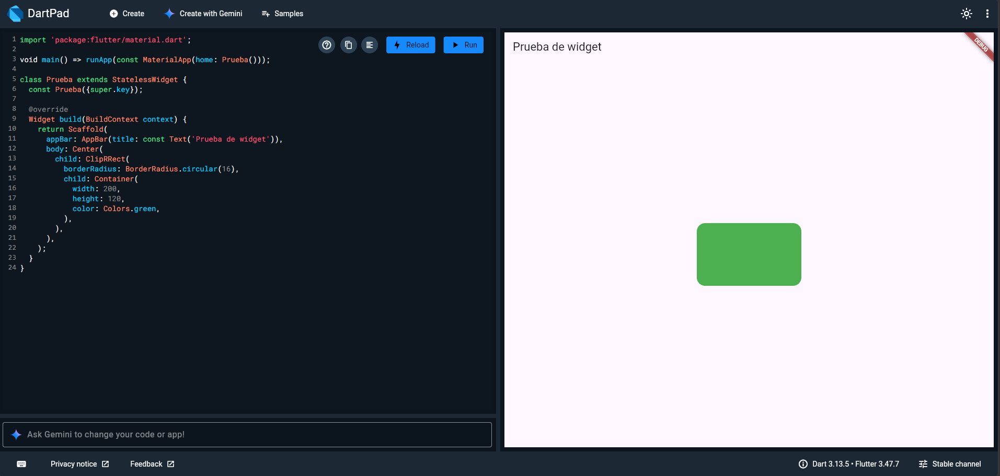
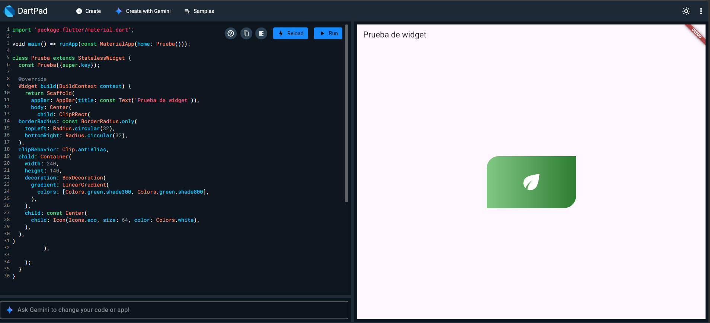
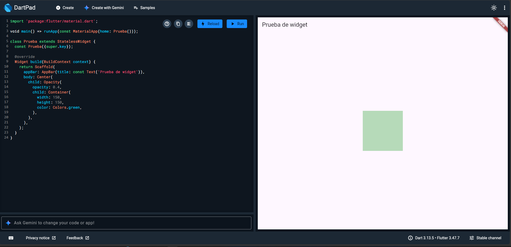
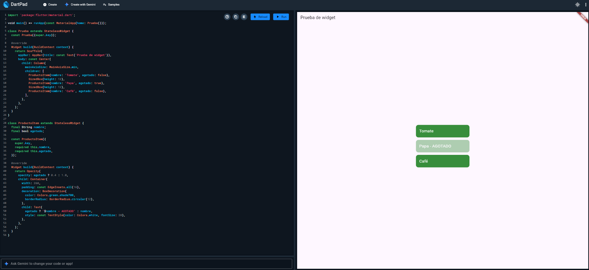
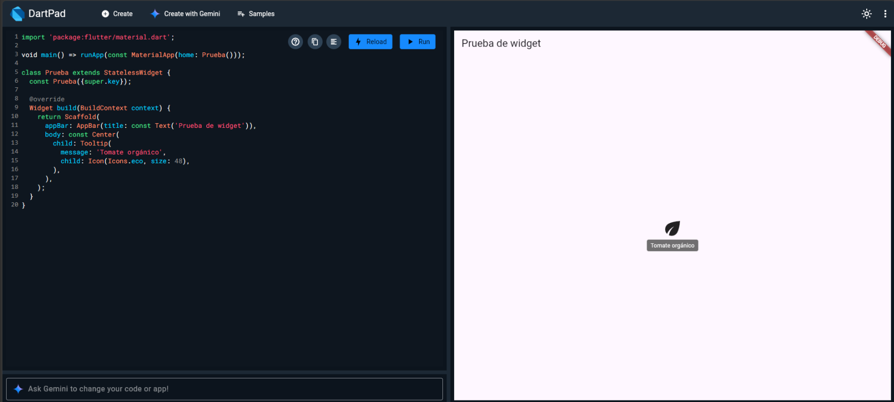
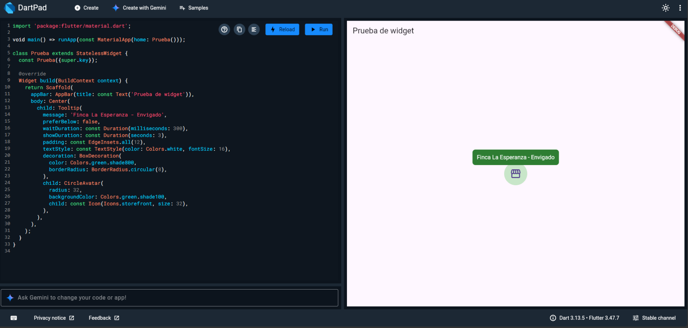

# Investigación de widgets de Flutter

**Nombre del estudiante:** Santiago Echeverri<br>
**Grupo:** 602<br>
**Fecha:** 23 de octubre de 2026<br>

**Mis widgets:** `ClipRRect`, `Opacity`, `Tooltip`


## 1. `ClipRRect`

### Qué es y para qué sirve

`ClipRRect` recorta a su hijo con esquinas redondeadas. Todo lo que quede fuera del borde redondeado
no se dibuja. La "RRect" viene de *rounded rectangle* (rectángulo redondeado).

Resuelve un problema muy común: una imagen o un contenedor es cuadrado y lo quiero con las esquinas
suaves. Sin `ClipRRect`, las esquinas de una imagen no se redondean aunque el padre tenga bordes
redondeados, porque la imagen se sale por encima.

### Cuándo usarlo y cuándo no

Es la mejor opción para redondear una imagen, por ejemplo la foto de un producto en una tarjeta. No
conviene cuando el contenido es un `Container` con color o decoración: ahí es mejor usar
`BoxDecoration(borderRadius: ...)`, porque recortar cuesta más que simplemente pintar. Si lo que
quiero es un círculo completo, `ClipOval` o `CircleAvatar` son más directos.

### Ejemplo mínimo

```dart
ClipRRect(
  borderRadius: BorderRadius.circular(16),
  child: Container(
    width: 200,
    height: 120,
    color: Colors.green,
  ),
)
```

**Resultado en DartPad:**



### Explicación del ejemplo

`borderRadius` indica cuánto se redondean las esquinas (16 en las cuatro). El `child` es un
rectángulo verde de 200x120. `ClipRRect` recorta ese rectángulo con las esquinas redondeadas, así que
el resultado es un rectángulo verde de bordes suaves.

### Propiedades importantes

| Propiedad | Qué hace | Ejemplo |
|---|---|---|
| `borderRadius` | Define el radio de las esquinas. Puede ser distinto por esquina. | `BorderRadius.circular(16)` |
| `child` | El widget que se va a recortar. | `child: Image.network(url)` |
| `clipBehavior` | Calidad del recorte. `antiAlias` suaviza el borde. | `clipBehavior: Clip.antiAlias` |
| `clipper` | Permite usar un recorte personalizado en vez de `borderRadius`. | `clipper: MiClipper()` |

### Ejemplo personalizado

```dart
ClipRRect(
  borderRadius: const BorderRadius.only(
    topLeft: Radius.circular(32),
    bottomRight: Radius.circular(32),
  ),
  clipBehavior: Clip.antiAlias,
  child: Container(
    width: 240,
    height: 140,
    decoration: BoxDecoration(
      gradient: LinearGradient(
        colors: [Colors.green.shade300, Colors.green.shade800],
      ),
    ),
    child: const Center(
      child: Icon(Icons.eco, size: 64, color: Colors.white),
    ),
  ),
)
```

**Resultado en DartPad:**



Aquí solo se redondean la esquina superior izquierda y la inferior derecha, con un recorte de
`antiAlias` para que el borde se vea suave. Dentro hay un degradado verde con una hoja, como si fuera
la imagen de un producto.

### Dónde lo usaría en Mercado Campesino

En las tarjetas de producto de la pantalla del catálogo, para que la foto de cada producto (tomates,
papas, café) tenga las esquinas redondeadas y todas se vean iguales aunque las fotos lleguen con
tamaños distintos.

### Fuentes y ayudas usadas

- Documentación oficial: https://api.flutter.dev/flutter/widgets/ClipRRect-class.html
- Probé los ejemplos en DartPad.
- Usé inteligencia artificial (Claude) como apoyo para estructurar el documento y revisar los
  ejemplos. Luego los probé y los modifiqué yo mismo para entenderlos.


## 2. `Opacity`

### Qué es y para qué sirve

`Opacity` hace que su hijo se vea más o menos transparente. Recibe un número entre 0.0 (invisible) y
1.0 (totalmente visible).

Sirve para mostrar que algo está deshabilitado, apagado o poco importante, o para ocultar algo sin
quitarlo del árbol de widgets, de modo que siga ocupando su espacio.

### Cuándo usarlo y cuándo no

Es buena opción para atenuar un producto agotado en una lista. No conviene cuando quiero animar el
cambio de transparencia: ahí uso `AnimatedOpacity`, que hace la transición solo. Tampoco sirve para
bloquear toques: un `Opacity` en 0 sigue recibiendo clics, y para eso se usa `IgnorePointer`.

### Ejemplo mínimo

```dart
Opacity(
  opacity: 0.4,
  child: Container(
    width: 150,
    height: 150,
    color: Colors.green,
  ),
)
```

**Resultado en DartPad:**



### Explicación del ejemplo

El cuadrado verde de 150x150 se dibuja al 40% de su opacidad, por lo que se ve claro y deja pasar el
fondo. Si cambio `opacity` a 1.0 se ve normal, y si lo pongo en 0.0 desaparece pero su espacio
sigue reservado.

### Propiedades importantes

| Propiedad | Qué hace | Ejemplo |
|---|---|---|
| `opacity` | Nivel de transparencia, de 0.0 a 1.0. | `opacity: 0.5` |
| `child` | El widget al que se le aplica la transparencia. | `child: Image.asset('papa.png')` |
| `alwaysIncludeSemantics` | Si el hijo sigue siendo leído por lectores de pantalla cuando es invisible. | `alwaysIncludeSemantics: true` |

Nota: `Opacity` tiene pocas propiedades, pero `opacity` es la que realmente cambia el resultado.

### Ejemplo personalizado

Una lista de productos donde los agotados se ven atenuados. Usa un widget propio que es `StatelessWidget`,
porque su aspecto solo depende de los datos que recibe (nombre y si está agotado).

```dart
class ProductoItem extends StatelessWidget {
  final String nombre;
  final bool agotado;

  const ProductoItem({
    super.key,
    required this.nombre,
    required this.agotado,
  });

  @override
  Widget build(BuildContext context) {
    return Opacity(
      opacity: agotado ? 0.4 : 1.0,
      child: Container(
        width: 260,
        padding: const EdgeInsets.all(16),
        decoration: BoxDecoration(
          color: Colors.green.shade700,
          borderRadius: BorderRadius.circular(12),
        ),
        child: Text(
          agotado ? '$nombre - AGOTADO' : nombre,
          style: const TextStyle(color: Colors.white, fontSize: 20),
        ),
      ),
    );
  }
}
```

Para probarlo en la plantilla de DartPad, dejo la clase `ProductoItem` al final del archivo y en el
`body` uso:

```dart
body: const Center(
  child: Column(
    mainAxisSize: MainAxisSize.min,
    children: [
      ProductoItem(nombre: 'Tomate', agotado: false),
      SizedBox(height: 12),
      ProductoItem(nombre: 'Papa', agotado: true),
      SizedBox(height: 12),
      ProductoItem(nombre: 'Café', agotado: false),
    ],
  ),
),
```

**Resultado en DartPad:**



El operador `agotado ? 0.4 : 1.0` decide la opacidad: si el producto está agotado se dibuja al 40% y si
no, al 100%. Así la papa se ve apagada y los otros dos normales, pero los tres ocupan su espacio.

### Dónde lo usaría en Mercado Campesino

En la lista de productos, para atenuar los productos agotados: se ven opacos, pero el usuario todavía
los reconoce y entiende que no están disponibles.

### Fuentes y ayudas usadas

- Documentación oficial: https://api.flutter.dev/flutter/widgets/Opacity-class.html
- Probé los ejemplos en DartPad.
- Usé inteligencia artificial (Claude) como apoyo para estructurar el documento y revisar los
  ejemplos. Luego los probé y los modifiqué yo mismo para entenderlos.


## 3. `Tooltip`

### Qué es y para qué sirve

`Tooltip` muestra un mensaje de texto flotante cuando el usuario mantiene presionado (en el celular)
o pasa el mouse por encima (en web y escritorio) del widget que envuelve.

Resuelve el problema de explicar qué hace un elemento, sobre todo los que solo tienen un ícono, sin
gastar espacio en pantalla. También ayuda a la accesibilidad, porque los lectores de pantalla leen el
mensaje.

### Cuándo usarlo y cuándo no

Es la mejor opción para aclarar un ícono sin texto, como un ícono de filtro en la barra superior. No
conviene para información importante que el usuario necesita ver sí o sí, porque en el celular
requiere una pulsación larga y mucha gente no la hace. Ahí es mejor poner un `Text` visible o un
`SnackBar`.

### Ejemplo mínimo

```dart
Tooltip(
  message: 'Tomate orgánico',
  child: Icon(Icons.eco, size: 48),
)
```

**Resultado en DartPad:**



### Explicación del ejemplo

`message` es el texto que aparece en el globo. `child` es el ícono de la hoja. Al mantener presionado
el ícono (o pasar el mouse en DartPad) aparece el globo con "Tomate orgánico".

### Propiedades importantes

| Propiedad | Qué hace | Ejemplo |
|---|---|---|
| `message` | Texto que se muestra en el globo. | `message: 'Agregar al carrito'` |
| `child` | Widget que activa el tooltip. | `child: Icon(Icons.eco)` |
| `preferBelow` | Si el globo sale debajo (true) o arriba (false) del widget. | `preferBelow: false` |
| `waitDuration` | Tiempo que debe esperar antes de aparecer. | `waitDuration: Duration(milliseconds: 300)` |
| `showDuration` | Cuánto tiempo permanece visible. | `showDuration: Duration(seconds: 3)` |
| `decoration` | Cambia el aspecto del globo (color, bordes). | `decoration: BoxDecoration(color: Colors.green)` |

### Ejemplo personalizado

```dart
Tooltip(
  message: 'Finca La Esperanza - Envigado',
  preferBelow: false,
  waitDuration: const Duration(milliseconds: 300),
  showDuration: const Duration(seconds: 3),
  padding: const EdgeInsets.all(12),
  textStyle: const TextStyle(color: Colors.white, fontSize: 16),
  decoration: BoxDecoration(
    color: Colors.green.shade800,
    borderRadius: BorderRadius.circular(8),
  ),
  child: CircleAvatar(
    radius: 32,
    backgroundColor: Colors.green.shade100,
    child: const Icon(Icons.storefront, size: 32),
  ),
)
```

**Resultado en DartPad:**



El globo sale por encima del avatar, espera 300 ms para aparecer, dura 3 segundos y tiene fondo verde
oscuro con esquinas redondeadas y texto blanco más grande.

### Dónde lo usaría en Mercado Campesino

En la barra superior del catálogo, sobre los íconos de filtrar y ordenar, para que el usuario sepa
qué hace cada uno. También sobre el ícono de la tienda de un productor, para mostrar el nombre de su
finca.

### Fuentes y ayudas usadas

- Documentación oficial: https://api.flutter.dev/flutter/material/Tooltip-class.html
- Probé los ejemplos en DartPad.
- Usé inteligencia artificial (Claude) como apoyo para estructurar el documento y revisar los
  ejemplos. Luego los probé y los modifiqué yo mismo para entenderlos.
