# Definición del proyecto DriveWise

## Ficha del proyecto

| Dato | Información |
|---|---|
| Proyecto | DriveWise |
| Asignatura | Programación Móvil (IF2004) |
| Grupo | 20262-IF2004-PROGRAMACIÓN MÓVIL-G602svg |
| Integrantes | Jorge Giraldo, Santiago Echeverri y Alejandra Villa |
| Versión del documento | 1.1 |
| Fecha de actualización | Noviembre de 2026 |

## Tabla de contenido

1. [Descripción general](#1-descripción-general)
2. [Problema](#2-problema)
3. [Objetivos](#3-objetivos)
4. [Stakeholders, actores y roles](#4-stakeholders-actores-y-roles)
5. [Alcance](#5-alcance)
6. [Funcionalidades](#6-funcionalidades)
7. [Requerimientos funcionales](#7-requerimientos-funcionales)
8. [Requerimientos no funcionales](#8-requerimientos-no-funcionales)
9. [Reglas de negocio](#9-reglas-de-negocio)
10. [Modelo de datos](#10-modelo-de-datos)
11. [Pantallas y mapa de navegación](#11-pantallas-y-mapa-de-navegación)
12. [Mockups de la aplicación](#12-mockups-de-la-aplicación)
13. [Historias de usuario, caso de uso, restricciones y supuestos](#13-historias-de-usuario-caso-de-uso-restricciones-y-supuestos)
14. [Arquitectura técnica y navegación implementada](#14-arquitectura-técnica-y-navegación-implementada)
15. [Historial de cambios y referencias](#15-historial-de-cambios-y-referencias)

---

## 1. Descripción general

DriveWise es una aplicación móvil pensada para ayudar a los usuarios a llevar un mejor control de la información relacionada con sus vehículos.

La idea es reunir en un mismo lugar datos que normalmente se encuentran separados, como los gastos, el combustible, los mantenimientos y los documentos del vehículo. También se contempla una sección de recordatorios para tener presentes fechas importantes, por ejemplo, el vencimiento del SOAT y de la revisión técnico-mecánica.

El proyecto se desarrolla como parte de la asignatura Programación Móvil (IF2004), utilizando Flutter y Dart.

## 2. Problema

Muchas personas llevan el control de los gastos, mantenimientos y documentos de sus vehículos de manera manual o utilizando diferentes herramientas. Esto puede dificultar la consulta de la información y hacer que se olviden fechas importantes, como el vencimiento de un documento o la fecha de un mantenimiento.

Además, cuando no se lleva un registro organizado, puede ser complicado conocer cuánto dinero se ha invertido en el vehículo o consultar qué trabajos se le han realizado.

Por esta razón, se propone DriveWise como una aplicación que permita organizar esta información y consultarla desde un solo lugar.

## 3. Objetivos

### Objetivo general

Desarrollar una aplicación móvil que permita organizar y consultar la información principal de uno o varios vehículos, incluyendo sus gastos, mantenimientos, documentos y recordatorios.

### Objetivos específicos

- Registrar y consultar la información de los vehículos.
- Registrar los gastos relacionados con un vehículo.
- Llevar un registro de los gastos de combustible.
- Registrar los mantenimientos realizados y los que se encuentren pendientes.
- Guardar y consultar la información de los documentos del vehículo.
- Mostrar recordatorios de fechas importantes.
- Consultar el historial de información del vehículo.

## 4. Stakeholders, actores y roles

El usuario principal de DriveWise es el propietario o responsable de un vehículo, quien utilizará la aplicación para organizar y consultar su información.

También se identifica al equipo de desarrollo, encargado de construir, probar y mantener la aplicación durante el proyecto académico.

| Actor | Descripción |
|---|---|
| Usuario | Persona que utiliza la aplicación para administrar la información de sus vehículos. |
| Administrador | Rol contemplado para la administración del sistema, si se requiere en una etapa posterior. |
| Equipo de desarrollo | Grupo encargado de analizar, diseñar, desarrollar y probar la aplicación. |

## 5. Alcance

DriveWise busca permitir el registro y consulta de vehículos, gastos, combustible, mantenimientos, documentos y recordatorios. La aplicación también contempla la consulta del historial relacionado con cada vehículo.

Para la entrega académica se trabajará sobre las pantallas principales y la navegación de la aplicación, y se avanzará en el almacenamiento local de la información utilizando los contenidos vistos en clase.

El alcance se desarrollará por etapas. Las pantallas que aparecen en los mockups representan la propuesta visual del proyecto; esto no significa que todas sus funciones estén implementadas en la versión actual.

No se contemplan para esta primera etapa las compras, los pagos dentro de la aplicación ni la venta de vehículos. Las integraciones con servicios externos dependerán de que se encuentre una API adecuada y viable para el alcance de la asignatura.

## 6. Funcionalidades

Las funcionalidades previstas para DriveWise son:

- Inicio de sesión.
- Registro de usuario.
- Registro y consulta de vehículos.
- Consulta de la información del vehículo.
- Registro y consulta de gastos.
- Registro de combustible.
- Registro y consulta de mantenimientos.
- Consulta de documentos del vehículo.
- Recordatorios de fechas importantes.
- Consulta del historial del vehículo.
- Preferencia de tema claro u oscuro.

En la versión revisada del proyecto ya existen pantallas para inicio de sesión, inicio o Dashboard, información del vehículo, gastos, nuevo gasto, mantenimiento, recordatorios y detalle del SOAT. Algunas presentan información de ejemplo y otras tienen navegación o captura de datos parcialmente implementadas. El registro de usuario y el perfil aparecen en los mockups como parte de la propuesta visual, pero no se consideran pantallas funcionales de la versión actual.

## 7. Requerimientos funcionales

Los siguientes requerimientos describen lo que se espera que permita hacer la aplicación. Su inclusión en esta definición no significa que todos estén terminados.

| ID | Requerimiento funcional |
|---|---|
| RF-01 | El usuario podrá ingresar a la aplicación desde la pantalla de inicio de sesión. |
| RF-02 | El sistema contemplará el registro de un usuario. |
| RF-03 | El usuario podrá registrar la información de un vehículo. |
| RF-04 | El usuario podrá consultar la información de sus vehículos. |
| RF-05 | El usuario podrá registrar gastos asociados a un vehículo. |
| RF-06 | El usuario podrá consultar los gastos registrados. |
| RF-07 | El usuario podrá registrar información de combustible. |
| RF-08 | El usuario podrá registrar y consultar mantenimientos. |
| RF-09 | El usuario podrá guardar y consultar información de los documentos del vehículo. |
| RF-10 | El sistema mostrará recordatorios relacionados con fechas importantes. |
| RF-11 | El usuario podrá consultar el historial de información de su vehículo. |
| RF-12 | El usuario podrá seleccionar entre el tema claro y el tema oscuro. |

## 8. Requerimientos no funcionales

| ID | Requerimiento no funcional |
|---|---|
| RNF-01 | La aplicación debe ser sencilla de utilizar. |
| RNF-02 | La navegación entre las pantallas debe ser clara y coherente. |
| RNF-03 | La aplicación debe desarrollarse utilizando Flutter y Dart. |
| RNF-04 | La información debe presentarse de forma organizada y legible. |
| RNF-05 | Los formularios deben validar los datos obligatorios antes de aceptar un registro. |
| RNF-06 | La información que se implemente con persistencia local debe mantenerse disponible al cerrar y volver a abrir la aplicación. |

## 9. Reglas de negocio

| ID | Regla de negocio |
|---|---|
| RN-01 | Los gastos, registros de combustible y mantenimientos deben estar relacionados con un vehículo. |
| RN-02 | Los gastos deben registrar como mínimo la información necesaria para identificar el concepto y el valor. |
| RN-03 | Los documentos pueden tener una fecha de vencimiento. |
| RN-04 | Los mantenimientos pueden programarse por fecha o por kilometraje. |
| RN-05 | El kilometraje de un vehículo normalmente no debe ser inferior a un registro anterior. |
| RN-06 | Los recordatorios deben permitir identificar las fechas o actividades que requieren atención. |
| RN-07 | Los campos obligatorios de los formularios deben diligenciarse antes de guardar la información. |

## 10. Modelo de datos

La información de DriveWise se organiza alrededor del vehículo. Un usuario puede tener uno o varios vehículos y cada vehículo puede relacionarse con diferentes registros.

| Entidad | Descripción | Relación principal |
|---|---|---|
| Usuario | Persona que utiliza la aplicación. | Puede tener uno o varios vehículos. |
| Vehículo | Información básica del vehículo del usuario. | Se relaciona con gastos, combustible, mantenimientos, documentos y recordatorios. |
| Gasto | Registro de un gasto realizado en el vehículo. | Pertenece a un vehículo. |
| Combustible | Registro de consumo o carga de combustible. | Pertenece a un vehículo. |
| Mantenimiento | Registro de un mantenimiento realizado o pendiente. | Pertenece a un vehículo. |
| Documento | Información de documentos del vehículo y sus fechas. | Pertenece a un vehículo. |
| Recordatorio | Información de una fecha o actividad que el usuario debe tener presente. | Se relaciona con un vehículo. |

Relación general de las entidades:

```text
Usuario
   |
   +--- Vehículo
          |
          +--- Gastos
          |
          +--- Combustible
          |
          +--- Mantenimientos
          |
          +--- Documentos
          |
          +--- Recordatorios
```

Este modelo representa la organización conceptual de la información del proyecto. La estructura definitiva de las tablas y sus campos se establecerá cuando se implemente la persistencia local.

## 11. Pantallas y mapa de navegación

### 11.1 Pantallas contempladas en los mockups

| ID | Pantalla | Descripción | Estado en el código revisado |
|---|---|---|---|
| P-01 | Inicio de sesión | Permite ingresar a la aplicación. | Existe pantalla navegable; no valida credenciales reales. |
| P-02 | Registro de usuario | Permite crear los datos de un usuario. | Mockup de referencia; no implementada como pantalla funcional. |
| P-03 | Dashboard o Inicio | Muestra un resumen y accesos a las secciones principales. | Implementada visualmente, con información de ejemplo. |
| P-04 | Mi vehículo | Muestra información general del vehículo. | Implementada con información de ejemplo. |
| P-05 | Mantenimiento | Presenta información de mantenimientos, próximos e historial. | Implementada con datos estáticos. |
| P-06 | Nuevo gasto | Permite ingresar la información de un gasto. | Formulario implementado con validaciones y retorno del objeto. |
| P-07 | Gastos | Muestra los gastos registrados. | Implementada; los datos actuales se mantienen en memoria. |
| P-08 | Recordatorios | Muestra recordatorios del vehículo. | Implementada con información de ejemplo. |
| P-09 | Detalle SOAT | Muestra información relacionada con el SOAT. | Implementada con información fija. |
| P-10 | Perfil | Presenta la información del usuario. | Mockup de referencia; no implementada como pantalla funcional. |

### 11.2 Mapa de navegación

El flujo principal comienza en la pantalla de inicio de sesión y continúa hacia el Dashboard. Desde allí se puede acceder a las secciones principales. La pantalla de Mi vehículo permite entrar a Mantenimiento, y desde Recordatorios se puede consultar el detalle del SOAT. Desde Gastos se puede abrir el formulario Nuevo gasto.

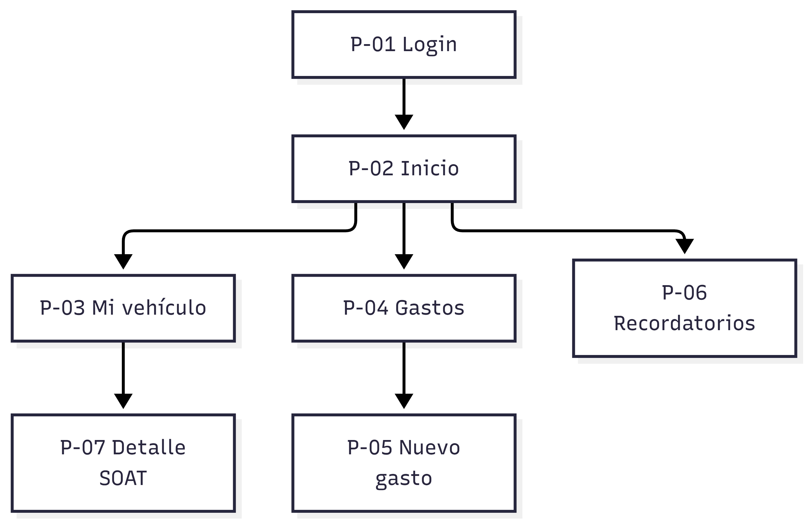

### 11.3 Navegación representada de forma simplificada

```text
                  +------------------+
                  | P-01 Login       |
                  +------------------+
                           |
                           v
                  +------------------+
                  | P-03 Dashboard    |
                  +------------------+
                    /      |       \
                   v       v        v
          +------------+ +------+ +----------------+
          | P-04 Mi    | | P-07 | | P-08           |
          | vehículo   | |Gastos| | Recordatorios  |
          +------------+ +------+ +----------------+
                 |          |             |
                 v          v             v
          +------------+ +----------+ +------------+
          | P-05       | | P-06     | | P-09       |
          |Mantenimiento| |Nuevo gasto| |Detalle SOAT|
          +------------+ +----------+ +------------+
```

El registro de usuario (P-02) y el perfil (P-10) forman parte de los diseños de referencia, pero no están conectados al flujo funcional actual.

## 12. Mockups de la aplicación

Los siguientes mockups se elaboraron como referencia visual para el diseño de DriveWise. Se incluyen directamente en este documento para que puedan consultarse sin abrir cada imagen por separado. Las imágenes se encuentran en la carpeta `docs/pantallas/` del proyecto y se muestran aquí mediante rutas relativas, por lo que deben conservarse junto con este archivo `definicion.md`.

### P-01. Inicio de sesión

Esta pantalla representa el ingreso del usuario a la aplicación.

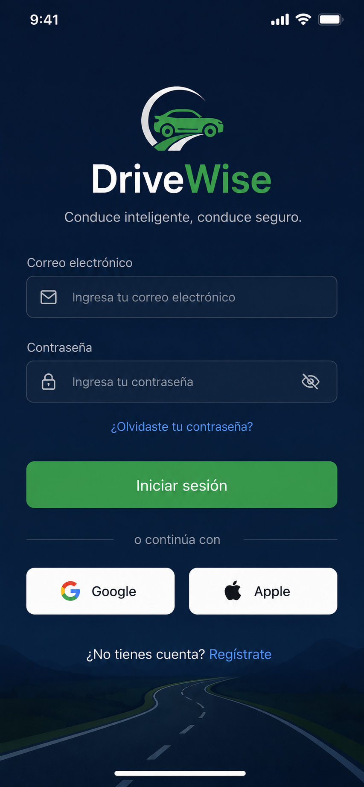

### P-02. Registro de usuario

Esta pantalla representa el formulario propuesto para crear una cuenta de usuario.

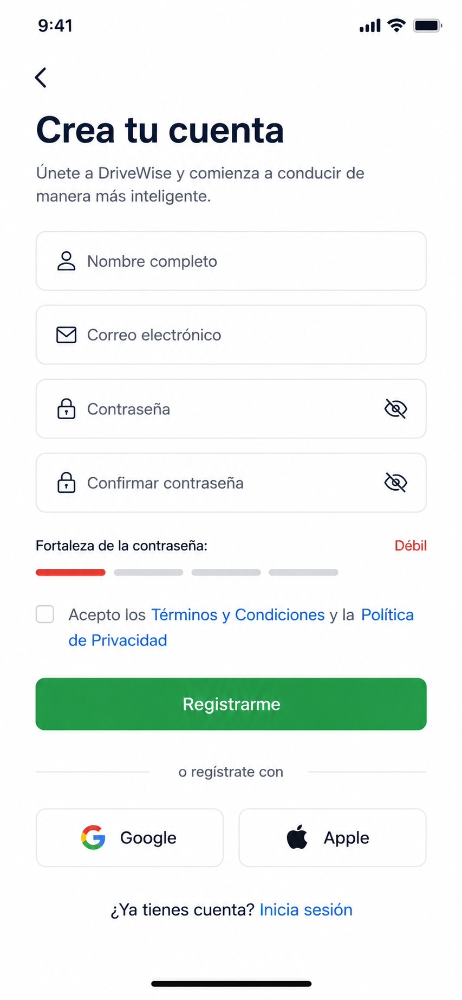

### P-03. Dashboard o Inicio

Esta pantalla presenta un resumen general del vehículo y accesos a las principales funciones de la aplicación.

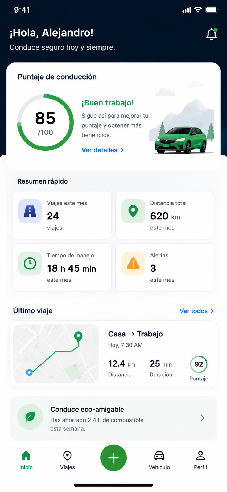

### P-04. Mi vehículo

Esta pantalla muestra la información general del vehículo registrado.

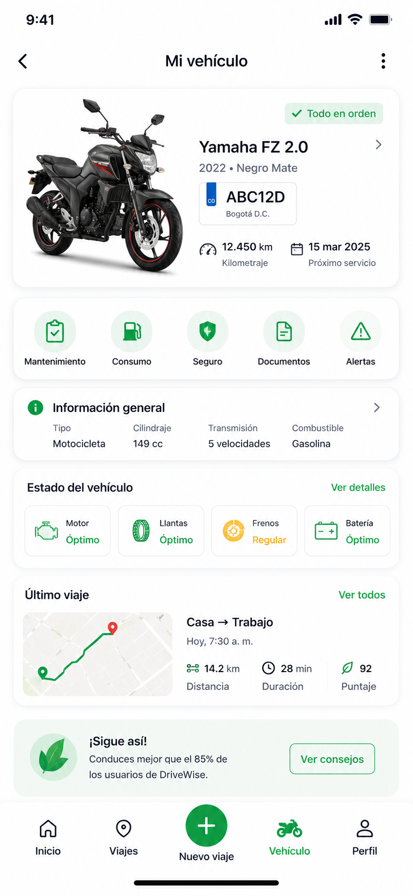

### P-05. Mantenimiento

Esta pantalla permite visualizar la propuesta de organización de los mantenimientos, tanto los próximos como los realizados.

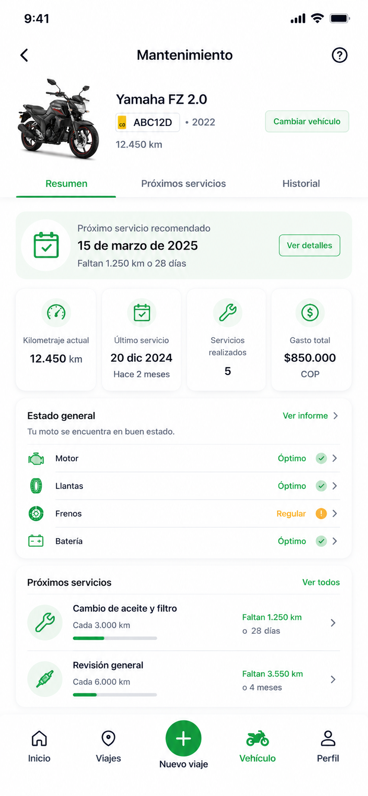

### P-06. Nuevo gasto

Esta pantalla representa el formulario para registrar un gasto relacionado con el vehículo.

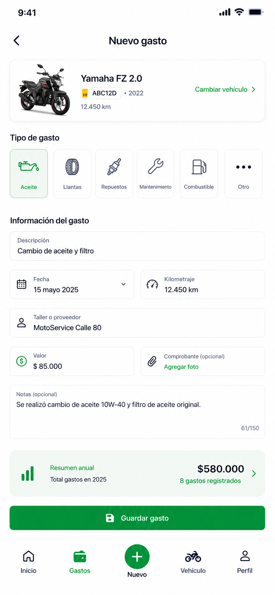

### P-07. Gastos

Esta pantalla presenta la propuesta visual del listado y resumen de gastos.

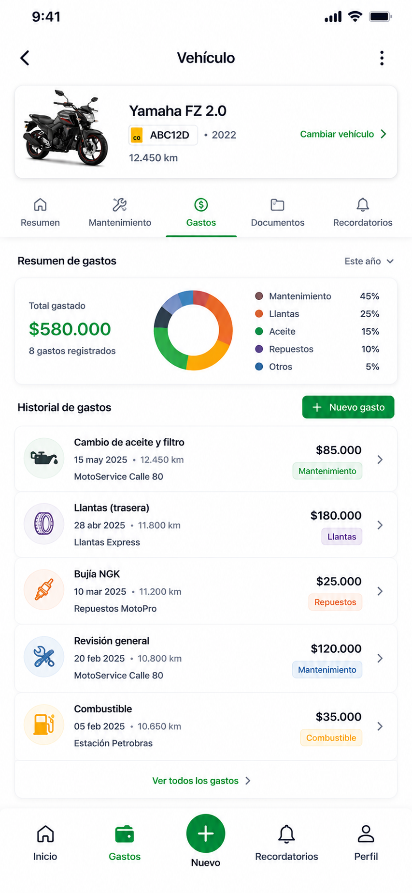

### P-08. Recordatorios

Esta pantalla reúne los recordatorios relacionados con documentos y actividades del vehículo.

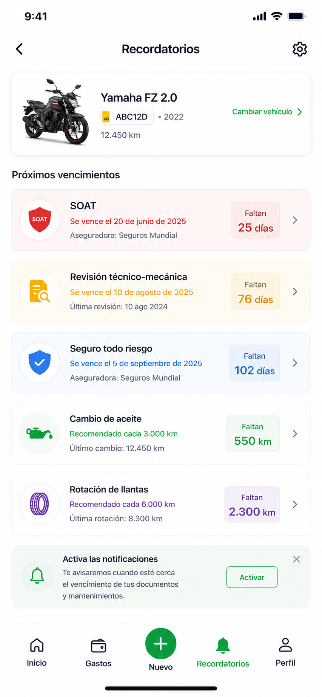

### P-09. Detalle SOAT

Esta pantalla muestra la información propuesta para consultar los datos del SOAT.

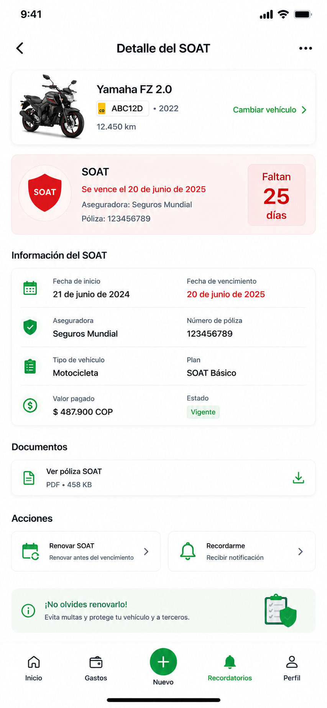

### P-10. Perfil

Esta pantalla representa la información del perfil del usuario.

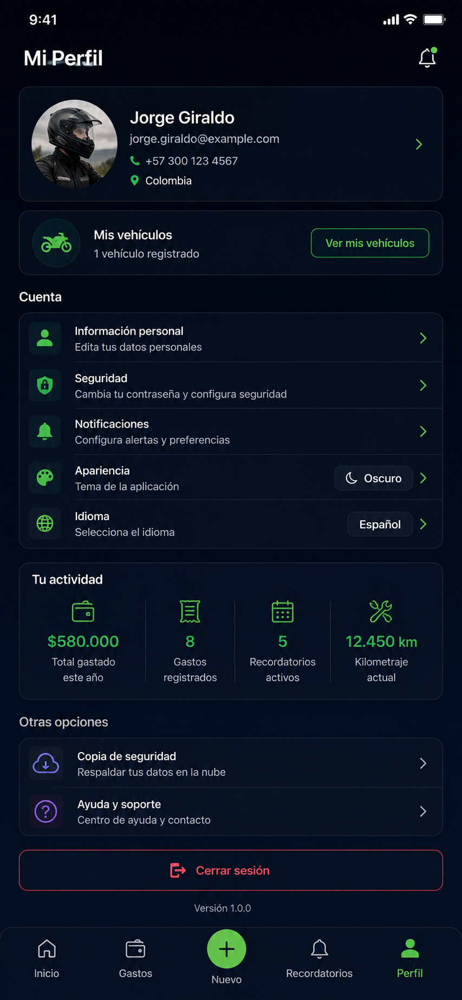

## 13. Historias de usuario, caso de uso, restricciones y supuestos

### 13.1 Historias de usuario

**HU-01:** Como usuario quiero registrar mi vehículo para tener su información organizada en la aplicación.

**HU-02:** Como usuario quiero registrar los gastos de mi vehículo para llevar un control del dinero que invierto en él.

**HU-03:** Como usuario quiero registrar los mantenimientos para consultar qué trabajos se le han realizado al vehículo.

**HU-04:** Como usuario quiero consultar recordatorios para no olvidar fechas importantes relacionadas con mi vehículo.

**HU-05:** Como usuario quiero consultar los documentos del vehículo para tener su información reunida en un mismo lugar.

### 13.2 Caso de uso principal: administrar la información del vehículo

El usuario ingresa a la aplicación y accede al Dashboard. Desde allí puede consultar la información general del vehículo y entrar a las secciones disponibles, como gastos, mantenimientos y recordatorios. En la sección de gastos puede abrir el formulario, diligenciar la información solicitada y regresar al listado para consultar el registro.

### 13.3 Restricciones

- La aplicación se desarrolla utilizando Flutter y Dart.
- El desarrollo debe mantenerse dentro de los conceptos, herramientas y paquetes trabajados en la asignatura.
- La navegación debe ser sencilla y permitir regresar a las pantallas anteriores.
- Las pantallas deben conservar una presentación coherente con los diseños definidos para el proyecto.
- Las funcionalidades se implementarán por etapas, de acuerdo con el tiempo y el alcance de la entrega académica.

### 13.4 Supuestos

- El usuario tendrá acceso a un dispositivo compatible con la aplicación.
- El usuario ingresará información correcta sobre su vehículo y sus registros.
- Los recordatorios dependerán de las fechas o datos que se encuentren registrados.
- Las funciones que requieran servicios externos dependerán de la disponibilidad y condiciones de las API utilizadas.
- Los mockups representan una guía visual y pueden ajustarse durante el desarrollo para mantener coherencia con las funcionalidades implementadas.

## 14. Arquitectura técnica y navegación implementada

### 14.1 Tecnologías

DriveWise está desarrollado con Flutter y Dart. La interfaz utiliza los componentes de Material de Flutter.

La versión de SDK declarada en el proyecto es Dart `^3.12.2`. La aplicación se organiza en archivos Dart separados para las pantallas y en una carpeta para algunos widgets reutilizables.

### 14.2 Estructura actual del código

```text
lib/
├── main.dart
├── login.dart
├── mi_vehiculo.dart
├── mantenimiento.dart
├── detalle_soat.dart
├── gastos.dart
├── nuevo_gasto.dart
├── recordatorios.dart
└── widgets/
    ├── reminder_card.dart
    ├── summary_card.dart
    └── vehicle_status_row.dart
```

### 14.3 Descripción de los archivos principales

| Archivo | Responsabilidad |
|---|---|
| `main.dart` | Inicia la aplicación, configura el tema y contiene la pantalla Dashboard. |
| `login.dart` | Presenta la pantalla de inicio de sesión y permite continuar al Dashboard. |
| `mi_vehiculo.dart` | Presenta la información general del vehículo y el acceso a mantenimiento. |
| `mantenimiento.dart` | Presenta las secciones de resumen, próximos mantenimientos e historial. |
| `detalle_soat.dart` | Muestra la información de detalle del SOAT. |
| `gastos.dart` | Presenta el listado de gastos y permite abrir el formulario para crear uno nuevo. |
| `nuevo_gasto.dart` | Contiene el formulario de registro de gastos y sus validaciones. |
| `recordatorios.dart` | Presenta los recordatorios y permite consultar el detalle del SOAT. |
| `widgets/reminder_card.dart` | Widget reutilizable para mostrar un recordatorio. |
| `widgets/summary_card.dart` | Widget reutilizable para mostrar información resumida. |
| `widgets/vehicle_status_row.dart` | Widget reutilizable para mostrar el estado de un elemento del vehículo. |

### 14.4 Navegación y paso de información

La navegación entre pantallas se realiza principalmente con `Navigator.push`, `Navigator.pushReplacement` y `Navigator.pop`, utilizando `MaterialPageRoute`.

| Pantalla de origen | Acción | Pantalla de destino | Información que se pasa |
|---|---|---|---|
| Login | Iniciar sesión en la versión actual | Dashboard | Parámetros de tema y función para cambiarlo. |
| Dashboard | Seleccionar Gastos | Gastos | No se pasa un registro específico. |
| Dashboard | Seleccionar Mi vehículo | Mi vehículo | No se pasa un registro específico. |
| Dashboard | Cerrar sesión | Login | Parámetros de tema y función para cambiarlo. |
| Mi vehículo | Seleccionar Mantenimiento | Mantenimiento | No se pasa un registro específico. |
| Gastos | Seleccionar Nuevo gasto | Nuevo gasto | Se espera un objeto `Gasto` como resultado al regresar. |
| Nuevo gasto | Guardar el formulario | Gastos | Devuelve el objeto `Gasto` mediante `Navigator.pop`. |
| Recordatorios | Consultar SOAT | Detalle SOAT | La pantalla de detalle muestra información fija. |

### 14.5 Estado actual y aspectos pendientes

La versión revisada contiene las pantallas principales y permite recorrer varias de ellas. El formulario de gastos permite capturar datos, validar campos y devolver un objeto a la pantalla del listado. Sin embargo, los datos de ejemplo y los nuevos gastos se mantienen actualmente en memoria, por lo que todavía no existe persistencia local mediante SQLite.

También quedan pendientes, entre otros aspectos, completar la validación del inicio de sesión, conectar los accesos que aún no tienen una acción, implementar el almacenamiento local, guardar la preferencia del tema y ampliar las pruebas de la aplicación.

La implementación de estas funciones se realizará progresivamente y utilizando los contenidos vistos en clase.

## 15. Historial de cambios y referencias

### 15.1 Historial de cambios

| Versión | Fecha | Cambio |
|---|---|---|
| 1.0 | 2026 | Creación de la documentación inicial del proyecto. |
| 1.1 | Noviembre de 2026 | Corrección de estructura y formato, actualización de pantallas y navegación, e inclusión directa de los diez mockups en el documento. |

### 15.2 Referencias

- Guía y materiales de la asignatura Programación Móvil (IF2004).
- Documentación oficial de Flutter: https://docs.flutter.dev/
- Documentación oficial de Dart: https://dart.dev/guides

### 15.3 Uso de inteligencia artificial

Se utilizó inteligencia artificial como apoyo para resolver dudas de programación, revisar errores y comprender algunos de los conceptos utilizados durante el desarrollo. También se utilizó ChatGPT para generar las imágenes que sirvieron como mockups de referencia del proyecto.

El código y la documentación fueron revisados y adaptados por los integrantes del equipo.
